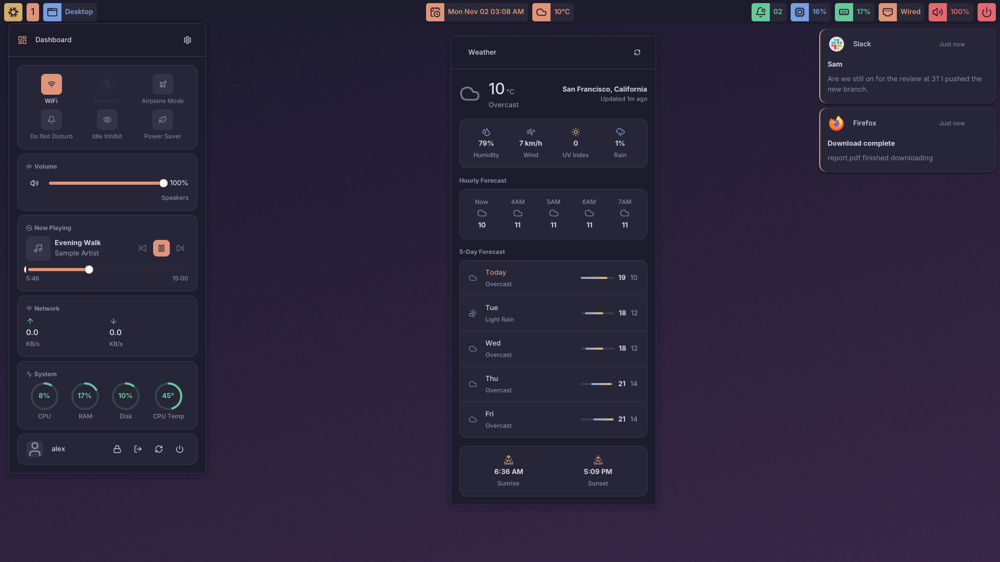

<p align="center">
  
</p>

<h1 align="center">lys-shell</h1>

<p align="center">
  A Wayland desktop shell in pure Go: bar, notifications, OSD, launcher, wallpaper, and a desktop portal.
</p>

<p align="center">
  <a href="https://github.com/stubbedev/lys-shell/actions/workflows/ci.yml"></a>
  <a href="LICENSE"></a>
  <a href="https://stubbedev.github.io/lys-shell/"></a>
</p>

<p align="center">
  
</p>

lys-shell runs on any compositor with `wlr-layer-shell`, including but not limited to [lys-wm](https://github.com/stubbedev/lys-wm). It is built on [lys-ui](https://github.com/stubbedev/lys-ui).

## Install

[Releases](https://github.com/stubbedev/lys-shell/releases) have a `.deb`, a Fedora `.rpm` and a tarball, for x86_64 and aarch64. The flake provides the package, a NixOS module and a home-manager module; see [NixOS](https://stubbedev.github.io/lys-shell/guide/getting-started-nixos).

From source, with Go and [just](https://github.com/casey/just):

```sh
git clone https://github.com/stubbedev/lys-shell
cd lys-shell
just build
sudo install -Dm755 dist/lys-shell dist/lys-lock -t /usr/local/bin
lys-shell icons setup
```

Runtime dependencies are listed in [Getting started](https://stubbedev.github.io/lys-shell/guide/getting-started).

## Usage

```sh
lys-shell panel start     # run the shell in the background
lys-shell panel settings  # open lys-settings, https://github.com/stubbedev/lys-settings
```

The config is `~/.config/lys-shell/config.yaml`; changes apply on save:

```yaml
bar:
  layout:
    - monitor: "*"
      left: [dashboard, hyprland-workspaces]
      center: [clock]
      right: [volume, network, bluetooth, battery]
```

## Documentation

The guides, the CLI and the config reference are at <https://stubbedev.github.io/lys-shell/>. For development, see [CLAUDE.md](CLAUDE.md).

## The lys family

[lys-wm](https://stubbedev.github.io/lys-wm/) (compositor), [lys-ui](https://stubbedev.github.io/lys-ui/) (widget toolkit), [lys-lib](https://stubbedev.github.io/lys-lib/) (building blocks), [lys-login](https://stubbedev.github.io/lys-login/) (display manager and lock screen), [lys-splash](https://stubbedev.github.io/lys-splash/) (boot splash), [lys-polkit](https://stubbedev.github.io/lys-polkit/) (polkit agent) and [lys-secrets](https://stubbedev.github.io/lys-secrets/) (Secret Service).

## Credits

The configuration format and much of the design come from [wayle-rs/wayle](https://github.com/wayle-rs/wayle). lys-shell shares no code with it.

## License

[MIT](LICENSE)

The passphrase generator embeds the words of the EFF large wordlist by the Electronic Frontier Foundation, under the Creative Commons Attribution 3.0 United States License; see [eff_large_wordlist.NOTICE](service/bitwarden/generator/eff_large_wordlist.NOTICE).
