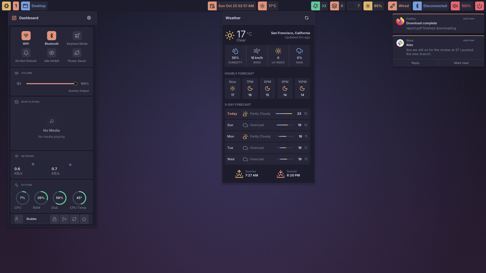
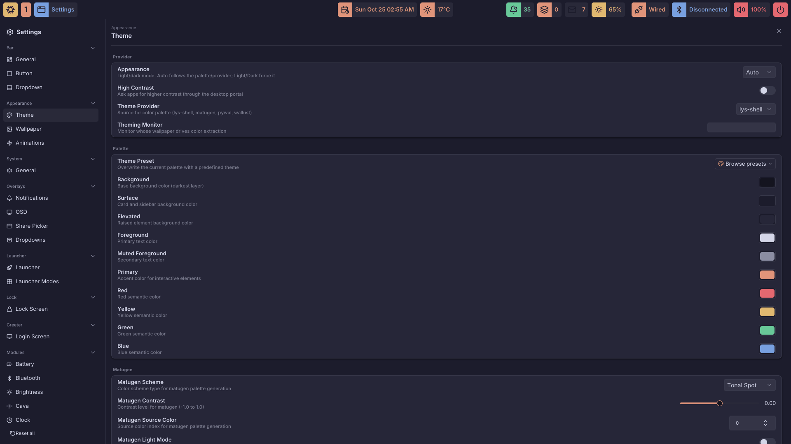

<p align="center">
  
</p>

<h1 align="center">lys-shell</h1>

<p align="center">
  A complete Wayland desktop shell in pure Go: bar, notifications, OSD, launcher, lock screen, greeter, wallpaper, and a desktop portal, as static Go binaries.
</p>

<p align="center">
  <a href="https://github.com/stubbedev/lys-shell/actions/workflows/ci.yml"></a>
  <a href="LICENSE"></a>
  <a href="https://stubbedev.github.io/lys-shell/"></a>
</p>

<p align="center">
  
</p>

## The lys family

lys-shell is one of three Go projects that together make a desktop, named after *lys*, Danish for light:

| Project | What it is |
| --- | --- |
| [lys-ui](https://github.com/stubbedev/lys-ui) | The toolkit: a pure-Go Wayland widget kit with GTK-flavoured CSS, the counterpart of GTK4 and relm4 |
| **lys-shell** | The desktop shell, built on lys-ui |
| [lys-wm](https://github.com/stubbedev/lys-wm) | A tiling Wayland compositor |

lys-shell runs on any compositor with `wlr-layer-shell`; it does not need lys-wm.

## What you get

**Bar.** Per-monitor layouts with groups and CSS classes, and the modules you would expect: clock and world clock, battery, power profiles, brightness, volume and microphone, network and VPN, bluetooth, media, cava visualizer, CPU, RAM, storage, network traffic, weather, mail, notifications, system tray, screen recorder, screenshot, idle inhibit, hyprsunset, keyboard layout and keybind mode, window title, a dashboard, and workspaces for Hyprland, Niri, Mango and Sway.

**Surfaces.** Notifications with popups and history, an OSD and custom toasts, a power menu, a rofi-compatible launcher (`lys-shell launcher`, also usable as `rofi` and dmenu), a native `ext-session-lock` lock screen, a greetd greeter, region and window screenshots, a colour picker, and a wallpaper engine with transitions and cycling.

**Desktop portal.** An `xdg-desktop-portal` backend covering FileChooser, ScreenCast and Screenshot with its own share picker, Print, AppChooser, Settings, Notification, Wallpaper, GlobalShortcuts, Clipboard, Inhibit and more, so GTK, Qt, Electron and Flatpak apps get native dialogs.

**Networking.** NetworkManager Wi-Fi and wired control, and VPNs signed in from the network dropdown, including GlobalProtect SAML through openconnect.

**Configuration.** YAML with imports and live reload, a [JSON schema](schema/lys-shell-config.schema.json) for editor completion, the `lys-settings` GUI, and the `lys-shell config` CLI. Every size takes a scale or exact pixels. Themes come from built-in palettes or from Matugen, Pywal and Wallust.

**Scriptable.** Custom bar modules backed by any command, with icon and colour maps keyed on their output; a JSON-RPC socket and `lys-shell widget update` to push updates to a widget; `lys-shell toast` for one-off messages.

<p align="center">
  
</p>

## Install

No prebuilt releases are published yet; build from this repository.

### NixOS and home-manager

The flake ships the package, a NixOS module and a home-manager module:

```nix
# flake.nix
{
  inputs.lys-shell.url = "github:stubbedev/lys-shell";
}
```

```nix
# NixOS configuration
{ inputs, ... }:
{
  imports = [ inputs.lys-shell.nixosModules.default ];
  programs.lys-shell = {
    enable = true;
    systemd.enable = true; # run the shell as a user service in the graphical session
    portal.enable = true; # register the desktop portal backend
    lock.enable = true; # PAM service for the lock screen
  };
}
```

The [NixOS guide](docs/guide/getting-started-nixos.md) covers the home-manager module and declarative settings.

### Other distributions

The binaries are static Go; at runtime they load GLib, GStreamer, PAM, PipeWire and GBM. With Go and [just](https://github.com/casey/just) installed:

```sh
git clone https://github.com/stubbedev/lys-shell
cd lys-shell
just build
sudo install -Dm755 dist/lys-shell dist/lys-settings dist/lys-greeter dist/lys-lock -t /usr/local/bin
lys-shell icons setup
lys-shell panel start
```

The guides for [Arch](docs/guide/getting-started-arch.md), [Debian and Ubuntu](docs/guide/getting-started-debian.md) and [Fedora](docs/guide/getting-started-fedora.md) list the packages to install; [Getting started](docs/guide/getting-started.md) covers the rest.

## Configure

lys-shell reads `~/.config/lys-shell/config.yaml` and applies changes on save:

```yaml
bar:
  location: top
  scale: 1.25
  layout:
    - monitor: "*"
      left: [dashboard, hyprland-workspaces]
      center: [clock]
      right: [volume, network, bluetooth, battery]
modules:
  clock:
    format: "%H:%M"
```

`lys-shell panel settings` opens the same config in the GUI. Start with the guides:

- [Editing config](docs/guide/editing-config.md): file layout, live reload, imports, CLI edits
- [Bars and layouts](docs/guide/bars-and-layouts.md): per-monitor layouts, groups, classes
- [Themes](docs/guide/themes.md) and [custom styles](docs/guide/custom-styles.md): palettes, theme providers, your own SCSS
- [Custom modules](docs/guide/custom-modules.md) and [custom icons](docs/guide/custom-icons.md)
- [Greeter](docs/guide/greeter.md): the greetd login screen
- [CLI](docs/guide/cli.md): every subcommand
- [Config reference](docs/config/): every field

## Develop

The flake's dev shell pins the Go toolchain and carries the linters and the headless sway, D-Bus and PipeWire the tests run against:

```sh
nix develop
just run shell    # run the shell from source
just check        # lint, tests, race detector, schema check
```

Every change lands with tests; see [CLAUDE.md](CLAUDE.md) for the conventions.

## Credits

lys-shell began as a fork of [wayle-rs/wayle](https://github.com/wayle-rs/wayle) and is now an independent Go implementation that shares none of its code; its configuration format and much of its design come from there.

## License

[MIT](LICENSE)
